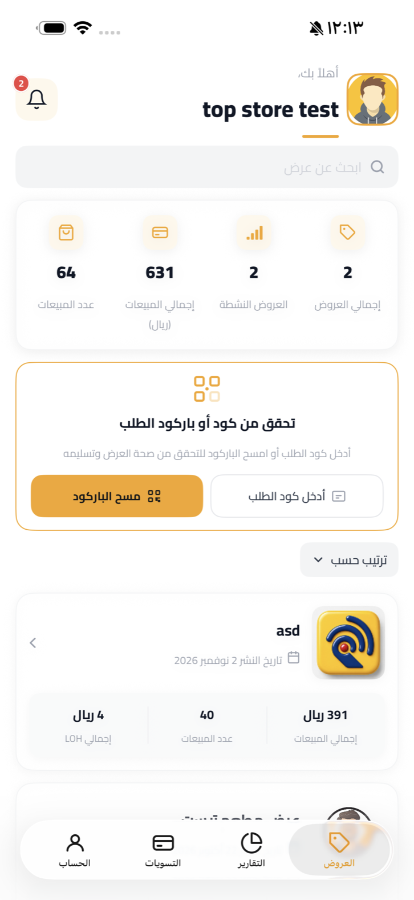
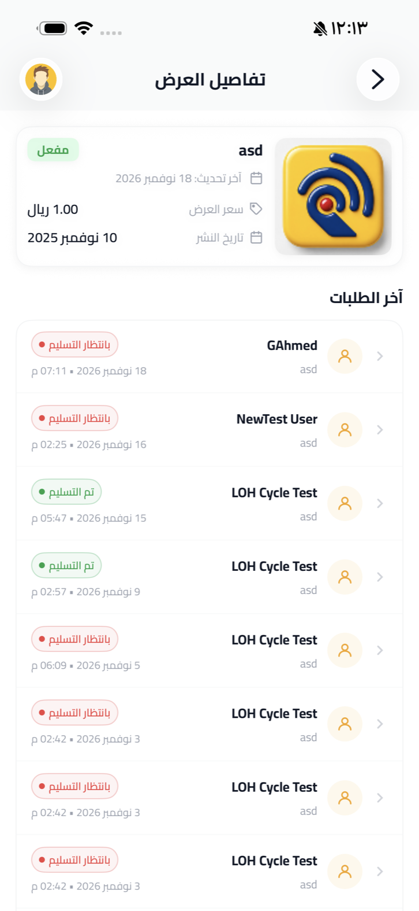
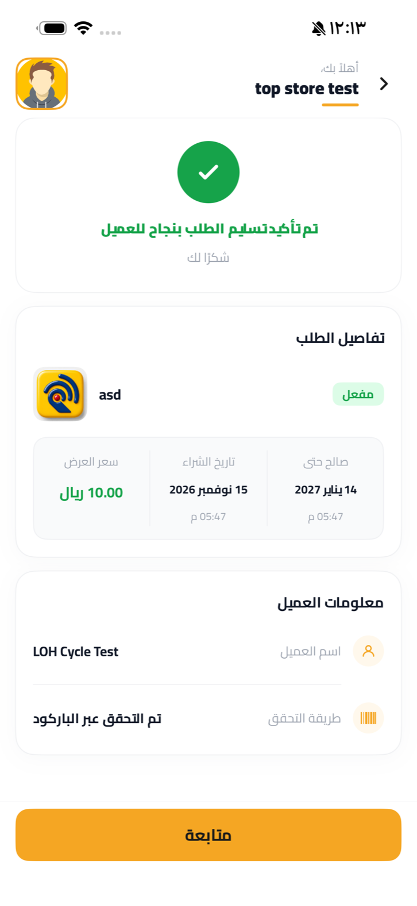
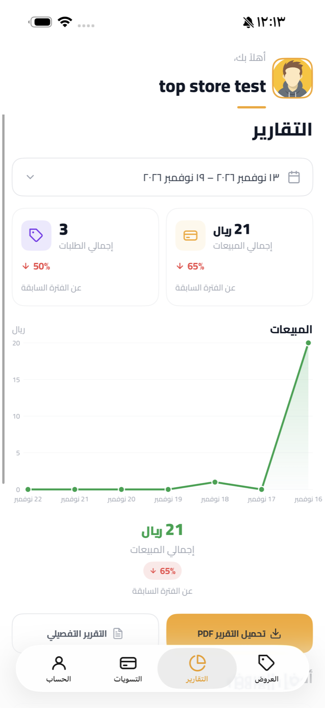
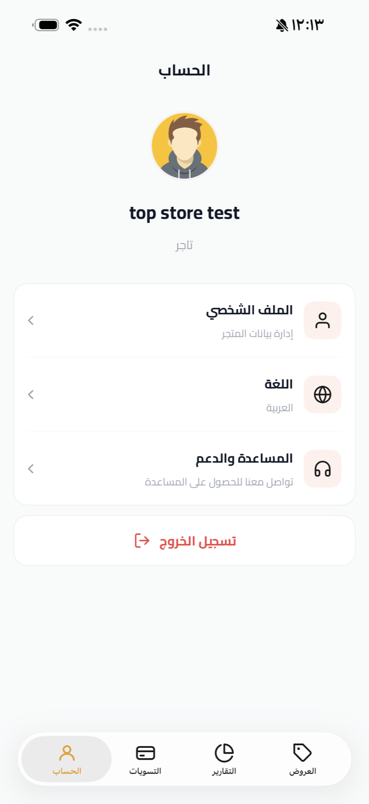

# LohProvider

LohProvider is an iPhone app for LOH merchants. It provides a workspace for managing promotional offers, validating customer orders, tracking sales, and handling day-to-day store account tasks. The interface supports Arabic and English, including right-to-left layouts.

## What the app offers

- **Offer management:** Browse and search store offers, review offer information, and see recent customer orders.
- **Order verification and delivery:** Enter a purchase code or scan a barcode, review the matching order, and confirm delivery.
- **Business reports:** Review sales and order activity over a selected period, view charts and offer summaries, and export reports as PDF.
- **Settlements:** Review settlement summaries and their details.
- **Store account:** View and manage merchant profile and language settings, and access support.

## Screenshots

The screenshots below show the Arabic merchant interface. Previews are intentionally compact; open an image to view it at full size.

<table>
  <tr>
    <th>Merchant dashboard</th>
    <th>Offer orders</th>
    <th>Delivery confirmation</th>
  </tr>
  <tr>
    <td></td>
    <td></td>
    <td></td>
  </tr>
  <tr>
    <td>See sales, active offers, and order totals. Start code entry or barcode scanning from the dashboard.</td>
    <td>Review an offer's status, price, publication details, and its recent customer orders.</td>
    <td>Confirm that an order was delivered and review the verification method and order summary.</td>
  </tr>
  <tr>
    <th>Reports</th>
    <th>Account and settings</th>
    <th></th>
  </tr>
  <tr>
    <td></td>
    <td></td>
    <td></td>
  </tr>
  <tr>
    <td>Select a reporting period, compare sales and order totals, inspect the chart, and export a detailed PDF.</td>
    <td>Open the store profile, change the app language, or access help and support.</td>
    <td></td>
  </tr>
</table>

## Technology

- Swift 5, SwiftUI, and UIKit integration.
- Observable view state with coordinator-based navigation.
- Arabic and English localization with right-to-left layout support.
- iOS dependencies managed through Swift Package Manager, including Alamofire, Firebase, Kingfisher, Google Maps, Lottie, and IQKeyboardManager.

## Project layout

```text
LohProvider/
├── App/             Merchant screens and retained app flows
├── Coordinator/     Merchant navigation and routing
├── Core/            App entry points, configuration, and assets
├── FCM/             Firebase messaging configuration and payload models
├── Networking/      Request execution and response handling
└── Shared/          Design system, localization, and reusable components
Scripts/             Project maintenance and validation helpers
Tests/                Standalone Swift check programs and fixtures
```

## Requirements

- Xcode
- iOS 16.4 or later

## Run in Xcode

1. Open `LohProvider.xcodeproj`.
2. Select the `LohProvider` scheme.
3. Choose an iOS simulator or connected iPhone.
4. Build and run the app.

Some merchant workflows use sample or in-memory data, while other features are connected to vendor services. Backend configuration and account access may be required for service-backed features.
